# lead-lifecycle-pipeline

A synthetic ad click becomes a lead. An AI triage workflow, running on self-hosted [Sim](https://github.com/simstudioai/sim),
proposes a disposition with evidence for every field, and a person approves it before anything is written to the CRM
(HubSpot). Sales outcomes recorded in the CRM go back to the ad platforms (Meta Conversions API, Google Data Manager
API, Microsoft Advertising) as consent-aware, deduplicated conversions, and a daily reconciliation accounts for every
record at every hop.

**Status:** early build. Everything here is synthetic. Platform responses are shown exactly as they came back,
including errors and test-mode results.

## Layout

```
apps/web        Next.js: demo sites, API routes, operator console, case studies (port 3100)
apps/worker     local worker and operations CLIs
packages/*      core, db (Prisma 7), queue (pg-boss), crm-hubspot, agent-runtime (Sim v2 API client),
                synthetic, capture, identity, destinations/*, corrections, reconciliation
sim/            the triage workflow as code (Sim CLI source directory)
evals/          labelled cases, deterministic scorers, recordings, reports
infra/          local Postgres; self-hosted Sim
docs/           ADRs, evidence from real platforms, QA write-ups
```

## Data model

Postgres through Prisma 7 ([`packages/db/prisma/schema.prisma`](packages/db/prisma/schema.prisma)). These are the
tables the triage agent needs. Attribution sessions, consent, identifiers, conversions, deliveries, corrections and
reconciliation come later. pg-boss keeps its own tables in the `pgboss` schema, outside Prisma. A few rules live in
the migration as CHECK constraints: reserved-domain emails only; `unknown` as the status of a run that timed out; a
decision always has an approver and a time; and a shadow run is never resumed.

The diagram is generated from the schema (`pnpm --filter @repo/db erd`), and a test fails if it is stale.

```mermaid
erDiagram
  Heartbeat {
    BigInt id PK
    String source
    String detail "nullable"
    DateTime createdAt
  }
  OAuthToken {
    BigInt id PK
    BigInt portalId UK
    Bytes refreshTokenCiphertext
    Bytes refreshTokenIv
    Bytes refreshTokenAuthTag
    String[] scopes
    DateTime accessTokenExpiresAt "nullable"
    DateTime createdAt
    DateTime updatedAt
    String installedVia
    DateTime lastRefreshedAt "nullable"
    DateTime refreshTokenRotatedAt "nullable"
    Json lastRefreshError "nullable"
    DateTime lastRefreshErrorAt "nullable"
  }
  Site {
    String id PK
    String key UK
    String name
    String domain UK
    Vertical vertical
    String timeZone
    Boolean sensitive
    Json routingConfig
    DateTime createdAt
    DateTime updatedAt
  }
  Lead {
    String id PK
    String siteId FK "nullable"
    String sessionId "nullable"
    LeadSource source
    String browserEventId UK "nullable"
    String email "nullable"
    String firstName "nullable"
    String lastName "nullable"
    String phone "nullable"
    String companyName "nullable"
    String jobTitle "nullable"
    String message "nullable"
    Json submission "nullable"
    DateTime submittedAt
    String submittedTimeZone
    String submittedAtLocal
    BigInt hubspotPortalId "nullable"
    BigInt hubspotContactId "nullable"
    TriageDisposition triageDisposition "nullable"
    DateTime dispositionAt "nullable"
    String syntheticKey UK "nullable"
    DateTime piiPurgedAt "nullable"
    DateTime createdAt
    DateTime updatedAt
  }
  CrmEvent {
    BigInt id PK
    String dedupeKey UK
    BigInt portalId
    BigInt appId "nullable"
    BigInt subscriptionId
    String subscriptionType
    String objectTypeId "nullable"
    BigInt objectId
    String propertyName "nullable"
    String propertyValue "nullable"
    BigInt eventId
    DateTime occurredAt
    String changeSource "nullable"
    String sourceId "nullable"
    Int attemptNumber
    Json rawPayload
    DateTime receivedAt
    String leadId FK "nullable"
  }
  AgentRun {
    String id PK
    String leadId FK
    BigInt crmEventId FK "nullable"
    String workflowId
    Int workflowVersion
    AgentRunMode mode
    String proposalRunId UK
    String resumeRunId UK "nullable"
    String inputHash
    String status
    Json output "nullable"
    TriageDisposition proposedDisposition "nullable"
    Float confidence "nullable"
    Decimal costUsd "nullable"
    Int latencyMs "nullable"
    Json error "nullable"
    DateTime startedAt "nullable"
    DateTime completedAt "nullable"
    DateTime createdAt
    DateTime updatedAt
  }
  Approval {
    String id PK
    String agentRunId FK, UK
    String simContextId
    Json diff
    ApprovalDecision decision "nullable"
    String approver "nullable"
    String comment "nullable"
    DateTime decidedAt "nullable"
    DateTime resumedAt "nullable"
    DateTime createdAt
    DateTime updatedAt
  }
  EvalCase {
    String id PK
    String key UK
    EvalSplit split
    String category
    Json snapshot
    Json expected
    String contentHash
    String promotedFromApprovalId FK, UK "nullable"
    DateTime createdAt
    DateTime updatedAt
  }
  EvalRun {
    String id PK
    String workflowId
    Int workflowVersion
    EvalSplit split
    String model "nullable"
    String sourceHash
    String status
    Json summary "nullable"
    String reportPath "nullable"
    DateTime startedAt
    DateTime completedAt "nullable"
  }
  EvalResult {
    String id PK
    String evalRunId FK
    String evalCaseId FK
    String simRunId UK
    String status
    Json output "nullable"
    Json scores
    Int latencyMs "nullable"
    Decimal costUsd "nullable"
    DateTime createdAt
  }
  Site |o--o{ Lead : "siteId"
  Lead |o--o{ CrmEvent : "leadId"
  Lead ||--o{ AgentRun : "leadId"
  CrmEvent |o--o{ AgentRun : "crmEventId"
  AgentRun ||--o| Approval : "agentRunId"
  Approval |o--o| EvalCase : "promotedFromApprovalId"
  EvalRun ||--o{ EvalResult : "evalRunId"
  EvalCase ||--o{ EvalResult : "evalCaseId"
```

<!-- erd:start -->


Enums:

- `Vertical`: `b2b_saas` · `rehab` · `clinic` · `local_services`
- `TriageDisposition`: `qualified` · `nurture` · `spam` · `duplicate` · `needs_review`
- `LeadSource`: `web_form` · `hubspot_direct`
- `AgentRunMode`: `shadow` · `propose`
- `ApprovalDecision`: `approved` · `rejected`
- `EvalSplit`: `dev` · `test`
<!-- erd:end -->

## Run it locally

```sh
pnpm install
cp .env.example .env
pnpm db:up            # Postgres on localhost:5433
pnpm db:generate
pnpm check            # lint, type-check, tests
pnpm --filter @repo/web dev   # http://localhost:3100
```

Decisions are recorded in [`docs/adr/`](docs/adr/).
